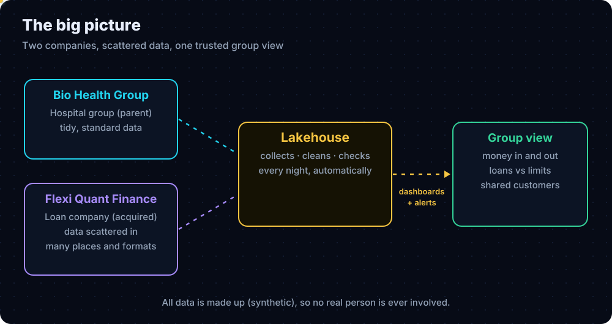
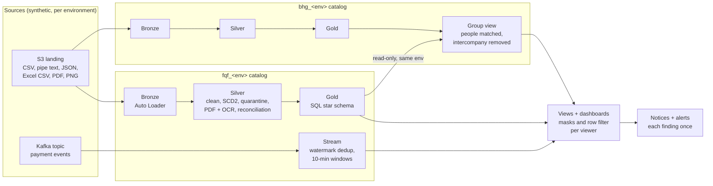
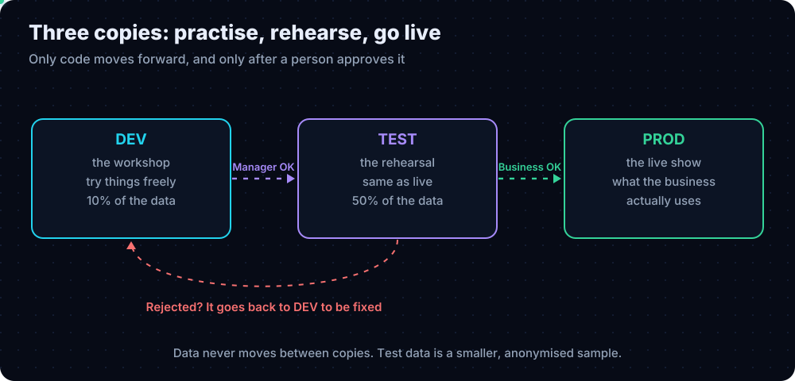

# Group Lakehouse: Bio Health Group × Flexi Quant Finance



An end-to-end **Databricks lakehouse** for a healthcare group (**Bio Health Group**, BHG) and the lender it acquired (**Flexi Quant Finance**, FQF). Each company has its own repository; this page brings both together in one place.

| Repository | What it holds | Open |
| --- | --- | --- |
| [`bio_health_group_hd`](https://github.com/the-naman/bio_health_group_hd) | The parent's lakehouse and the **group view** that combines both companies | [bhg_prod branch](https://github.com/the-naman/bio_health_group_hd/tree/bhg_prod) |
| [`flexi_quant_finance_fd`](https://github.com/the-naman/flexi_quant_finance_fd) | The acquired lender's lakehouse, built to the parent's standard, plus the **real-time payment stream** | [fqf_prod branch](https://github.com/the-naman/flexi_quant_finance_fd/tree/fqf_prod) |

The two folders above are Git submodules: links to the production branch of each repository. Nothing is copied; each project lives and changes only in its own repository.

## The problem

A healthcare group acquired a lender. The parent had standard pipelines; the child's data was spread over 8 sources in 6 formats, messy and duplicated. The task: build the child's pipelines to the parent's standard, keep every company and environment isolated, protect personal data, and give the parent one trustworthy group view every night, with only code (never data) moving between environments.



## Architecture



Each company has `dev`, `test` and `prod` catalogs with `bronze`, `silver`, `gold` and `ops`. BHG prod reads FQF prod Gold read-only for the group view. Code moves dev → test → prod through pull requests with approvals; data never moves between environments.



## What it proves

| Area | Proof (prod unless stated) |
| --- | --- |
| Messy sources | 24 tables in 6 formats, including a PDF bank statement and OCR of deposit-slip images; quarantine, orphans, late rows, a new column backfilled |
| History and modelling | SCD Type 2 in Silver; Gold in SQL (one file per table), point-in-time joins; every invoice and loan reconciles |
| Group view | 401 people matched across the two companies (of 1,180); 352 of 381 hospital-bill payouts matched; intercompany money counted once |
| Real time | Kafka → Structured Streaming → 10-minute windows → failed-payment velocity alert, mailed once |
| Release safety | Pull requests with approval, 10 checks + tests + CodeQL, a hotfix path with back-merge proven in prod, Databricks Asset Bundle validated in CI |
| Operations | Jobs as code on a nightly schedule, alerts and a weekly digest, runbook and disaster-recovery notes |
| Performance | Prod daily runs 11–14 min → 7–10 min after measured tuning |
| Security and privacy | Column masks, keyed tokens, row filters, service principals, secrets only in GitHub secrets and Databricks secret scopes. **All data is synthetic.** |

## Tech stack

Databricks · PySpark · Spark SQL · Delta Lake · Unity Catalog · Auto Loader · Structured Streaming · Kafka · Amazon S3 · GitHub Actions · Databricks Asset Bundles · Python

## Get both projects

```bash
git clone --recurse-submodules https://github.com/the-naman/bhg-fqf-lakehouse.git
```

Already cloned? Run `git submodule update --init`. Each folder is a full checkout of that repository's production branch.

## Read more

- **Plain-language walkthrough with diagrams:** [How I turned two companies' messy data into one trusted picture](https://kumarnaman.com/blog/databricks-lakehouse-explained)
- **Portfolio:** [kumarnaman.com](https://kumarnaman.com)
- **In each repository:** `docs/runbook.md`, `docs/disaster_recovery.md`, `docs/performance.md`, `docs/adr/` (decision records), `CHANGELOG.md`

## Keeping this page current

Dependabot checks both production branches once a month and opens a pull request when either has moved on; merging it points the folders at the newer commits. Neither project repository is changed by this page.
